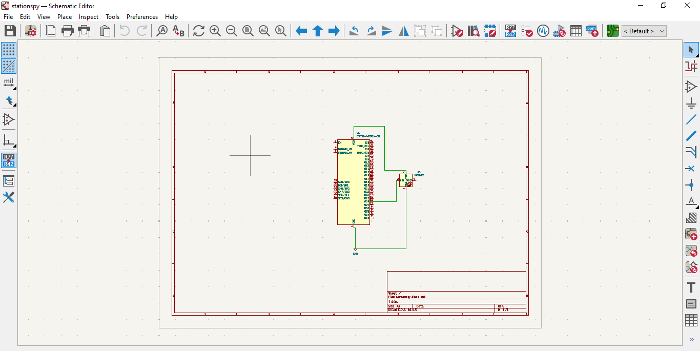
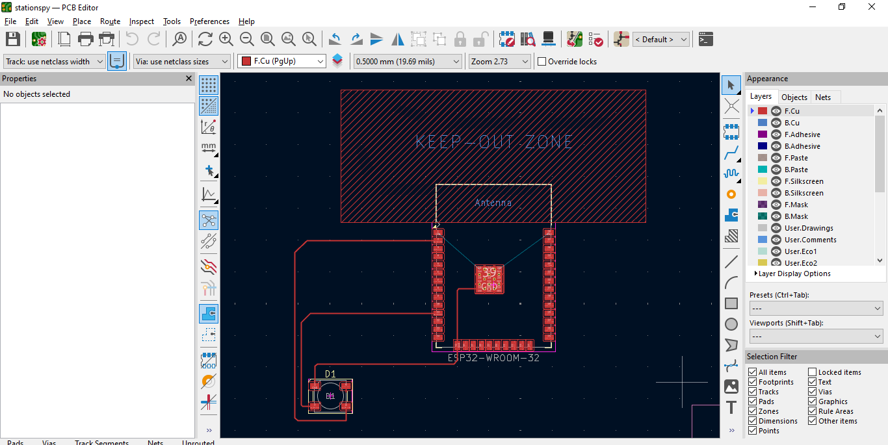

#SPY OF UNIVERSE 

well after so many mistakes writing my own redmi < WELL THIS IS MY PROJECT A CUSTOM SATELLITE TRACKER NOW I CAN TRACK NASA SATELLITES>

THATS HOW MY PROJECT LOOK LIKE 
#{CIRCUIT SCHEMATIC DIAGRAM }

#{ MY CIRCUIT BOARD LAYOUT}

#FEATURES 
* communicate directly with space station
* connect automatically with my hotspot
* it also change its colour RGB LED pixel

# CAD MODEL:
I think its fine looking 
*`station.spy`
